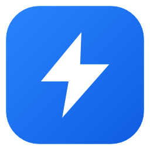

<p align="center"></p>

# Velo

**Fast downloads. A smoother internet.** Velo is an open-source download manager for Windows with a
browser extension for Chrome, Edge, Brave and Firefox.

- **Segmented downloads**: files are split into parts (16 by default) downloaded in parallel over
  separate connections. When a part finishes, its connection takes over half of the part with the most
  left, and servers that cap each connection (GitHub, many CDNs) automatically get more, up to 32.
- **Survives network drops**: a lost connection waits and resumes by itself; Windows is kept awake
  while downloading; free disk space is checked first.
- **Pause and resume**, even after closing Velo or restarting the PC.
- **Video grabber**: the extension finds HLS (`.m3u8`) and DASH (`.mpd`) streams and media files while
  a video plays. Velo picks the best quality and merges audio and video with ffmpeg.
- **Browser integration**: click a download link in Chrome, Edge, Brave or Firefox and Velo takes over: its download
  dialog opens (file name, size, folder, parts) instead of the browser's downloader. Can be set to
  start straight away instead. Plus a "Download with Velo" right-click item.
- **Updates**: Velo checks GitHub Releases, verifies the installer's SHA-256 and updates itself when
  idle; an unpacked extension reloads itself after an update.
- **Queue and scheduler**: downloads at once, a daily download window, and sleep or shut down when
  everything finishes.
- **Velo Mini**: a small always-on-top progress window in the corner while downloads run.
- **Download all with Velo**: right-click a page (or a selection) to send its links to Velo, then
  pick the files in a batch dialog. Cookies are only sent to links on the same site as the page.
- **Extension popup**: the videos found on the tab, a quality picker for HLS streams, and a
  "Link detected" card on pages that play a video (can be turned off).
- **Queue control**: start now, download next, move up and down; **refresh an expired link** and
  continue the same file; optional **checksum** (SHA-256, SHA-1, MD5) checked when done.
- **Proxy** (follows Windows by default) and **password-protected downloads**.
- **Portable version**: unzip and run; settings stay next to the program.
- **Eight languages**: English, বাংলা, Deutsch, Español, Français, हिन्दी, Português (Brasil) and 简体中文, following your Windows language (the extension follows the browser's).
- **Speed limit**, **auto-categorized folders** (Video, Music, Images, Documents, Compressed, Programs),
  **history**, **notifications**, **clipboard link detection**, light and dark themes.

Velo downloads what websites serve openly. It does not bypass DRM, encryption or other protections,
so protected streaming services and sites like YouTube are not supported.

## Install

Download `Velo-Setup-<version>.exe` from the releases page and run it. It installs for your user account
only (no administrator rights), adds Velo to the Start menu and to **Settings → Apps** for uninstalling,
and connects Chrome, Edge, Brave and Firefox. Then load the browser extension from
`%LOCALAPPDATA%\Programs\Velo\extension` (see below) until it's available in the browser stores.

Prefer no installer? `Velo-Portable-<version>.zip` runs from any folder (see its README.txt).

**Firefox**: install the Velo add-on from Firefox Add-ons once it is listed. To try it before that,
open `about:debugging` → This Firefox → Load Temporary Add-on and pick `manifest.json` from an unzipped
`velo-firefox-<version>.zip` (temporary add-ons are removed when Firefox closes).

The installer is not code-signed yet, so Windows SmartScreen may warn about an unknown publisher.

## Build a release

```powershell
.\tools\release.ps1 -Version 0.1.0
```

Writes `dist\Velo-Setup-0.1.0.exe` (the installer, which embeds the app and the extension),
`dist\Velo-Portable-0.1.0.zip`, `dist\velo-firefox-0.1.0.zip` (for Firefox Add-ons) and
`dist\velo-extension-0.1.0.zip` (for the Chrome Web Store and Edge Add-ons; see
[docs/store-listing.md](docs/store-listing.md) and [docs/privacy.md](docs/privacy.md)).

## Install (from source, for development)

Requirements: Windows 10/11, [Go](https://go.dev/) 1.27+, the WebView2 runtime (included with
Windows 11), and optionally [ffmpeg](https://ffmpeg.org/) on `PATH` for video streams.

```powershell
.\install.ps1
```

This builds `bin\velo.exe`, `bin\velo-host.exe` and `bin\veloctl.exe`, registers the native messaging
host for Chrome, Edge, Brave and Firefox (current user only) and adds Velo to the Start menu.

To change the icon, edit `tools/mkicon` and run `go run ./tools/mkicon` then `go generate ./cmd/velo`.

Then load the extension: open `chrome://extensions` or `edge://extensions`, turn on **Developer mode**,
click **Load unpacked** and choose the `extension` folder. Its ID is
`dmdcijgljocjdmafenflenjhdjhenokc`.

## Translations

Velo's text is written in English and translated at runtime. To add or fix a language:

1. Run `node tools/i18n/extract.js` to see any new English text, and add it to `internal/i18n/locales/app/keys.json` (or `ext/keys.json` for the extension).
2. Add the translation at the same position in `tools/i18n/app/<code>.json` (and `tools/i18n/ext/<code>.json`). A new language also goes in `Languages` in `internal/i18n/i18n.go`.
3. Run `node tools/i18n/build.js`. It checks every line keeps its `{0}` placeholders and HTML tags, and writes the files Velo and the extension load.

## Layout

| Path | What it is |
|---|---|
| `cmd/velo/` | The desktop app: tray icon, window (WebView2, `ui.html`), queue, scheduler, settings |
| `cmd/velo-host/` | Native messaging host: the browser starts it per message; it forwards to the app |
| `cmd/velo-setup/` | Installer and uninstaller (per user); embeds the release build |
| `cmd/veloctl/` | Command-line control: `list`, `add`, `pause`, `resume`, `remove`, `limit`, `get` |
| `internal/engine/` | Download engine: segmented HTTP, HLS, DASH, speed limit, categories |
| `internal/ipc/` | How the host and CLI find the app: `%APPDATA%\Velo\endpoint.json` (port + token) |
| `extension/` | Manifest V3 extension: download capture, video detection, popup, hover button |

### How the browser talks to Velo

The extension never opens a network port. It uses the browser's **native messaging**: Chrome starts
`velo-host.exe` (allowed only for Velo's extension ID) and exchanges length-prefixed JSON over stdin and
stdout. The host forwards each message to the app over `127.0.0.1` on a random port, with a random token
from `%APPDATA%\Velo\endpoint.json`, so web pages can't add downloads.

## Development

```powershell
go test -race ./...        # engine and app tests (local test servers, no internet needed)
go vet ./...
```

Data lives in `%APPDATA%\Velo` (settings, history, log). Set `VELO_HOME` to use another folder.

## License

[MIT](LICENSE)
